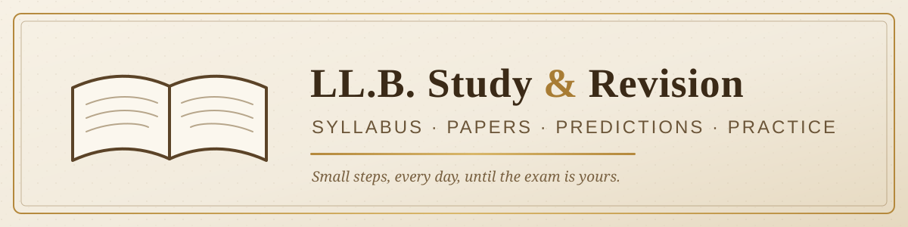

<div align="center">



<h1>LL.B. Study &amp; Revision</h1>

<p><em>A syllabus-first study and revision platform for LL.B. students.</em></p>

<p>
  
  
  
  
  
  
  
  
</p>

</div>

---

## 📑 Contents

- [✨ Features](#-features)
- [📚 Content](#-content)
- [🚀 Getting Started](#-getting-started)
- [🧰 Scripts](#-scripts)
- [💡 Philosophy](#-philosophy)
- [🧭 Project Structure](#-project-structure)

## ✨ Features

| | Feature | What it does |
|---|---|---|
| 📐 | Syllabus-first | Browse units and topics exactly as prescribed for each paper. |
| 📄 | Past papers | Read verified question papers without leaving the app. |
| 🔮 | Predictions | Topic-ranked guidance, clearly separated from verified material. |
| 🧠 | Revision | Turn topics into a repeatable routine with progress tracking. |
| 🔎 | Search | Find a topic, question or document instantly. |
| 💾 | Local-first | Everything lives in your browser — no account, no backend. |
| 📦 | Backup | Export and restore your study data. |

## 📚 Content

The app reads two kinds of content from `src/content/`:

- **Markdown documents** in `src/content/documents/` — syllabi, past papers and prediction reports.
- **Generated JSON** in `src/content/generated/content.json` — typed subjects, units, topics, questions and predictions.

Edit the Markdown, then run `npm run content:build` to regenerate the JSON. `src/content/index.ts` imports both, so both are committed to the repository.

## 🚀 Getting Started

```bash
npm install
npm run dev
```

The dev server starts on `http://localhost:5173`. To produce a production build in `dist/`, run `npm run build`.

## 🧰 Scripts

| Command | Description |
|---|---|
| `npm run dev` | Start the Vite dev server |
| `npm run build` | Type-check and build to `dist/` |
| `npm run preview` | Preview the production build |
| `npm run content:build` | Regenerate `src/content/generated/content.json` |
| `npm test` | Run the Vitest suites |
| `npm run lint` | Run ESLint |
| `npm run typecheck` | Type-check without emitting files |

## 💡 Philosophy

> "It always seems impossible until it's done." — Nelson Mandela

Exam preparation is rarely a single breakthrough; it is the compound result of small, deliberate sessions repeated over time. This platform is built on that belief. It keeps the syllabus at the centre, puts past papers within reach, and turns revision into a routine you can actually sustain — so that on exam day you are not hoping for the best, you are ready for it.

## 🧭 Project Structure

```text
src/
├── app/          # router
├── components/   # layout, academic and UI pieces
├── content/      # Markdown documents and generated JSON
├── database/     # Dexie schema
├── features/     # screens
├── hooks/        # shared app state
├── services/     # search and backup
├── styles/       # design tokens and CSS
├── tests/        # Vitest suites
└── types/        # domain models
```

---

<div align="center">

Built with React, TypeScript and Vite — for students who keep showing up.

</div>
